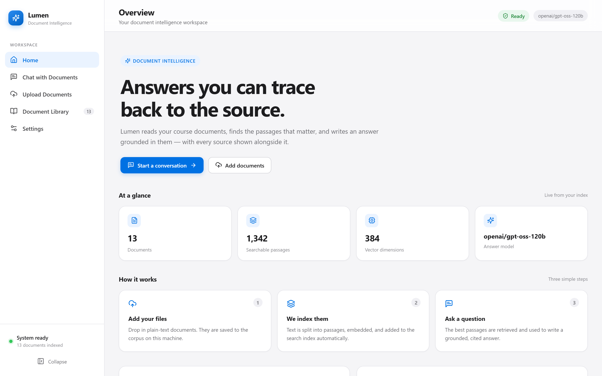
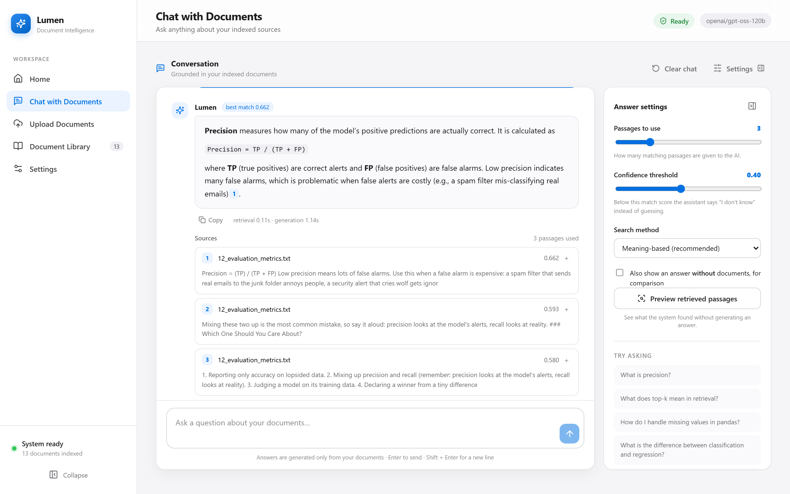
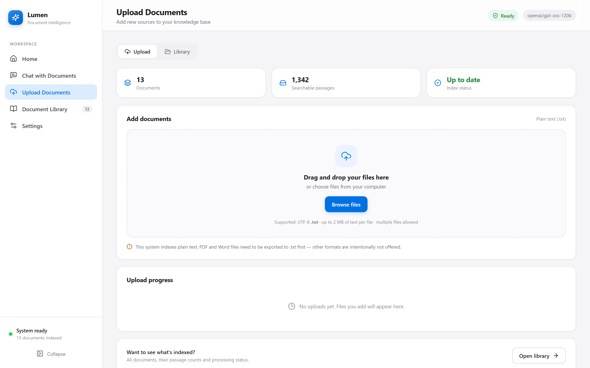
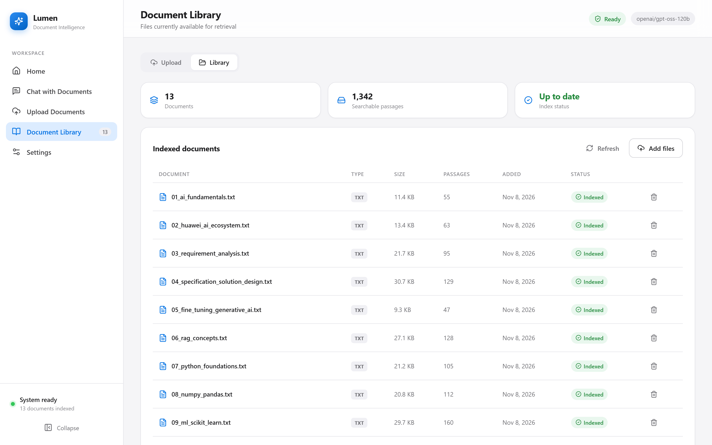
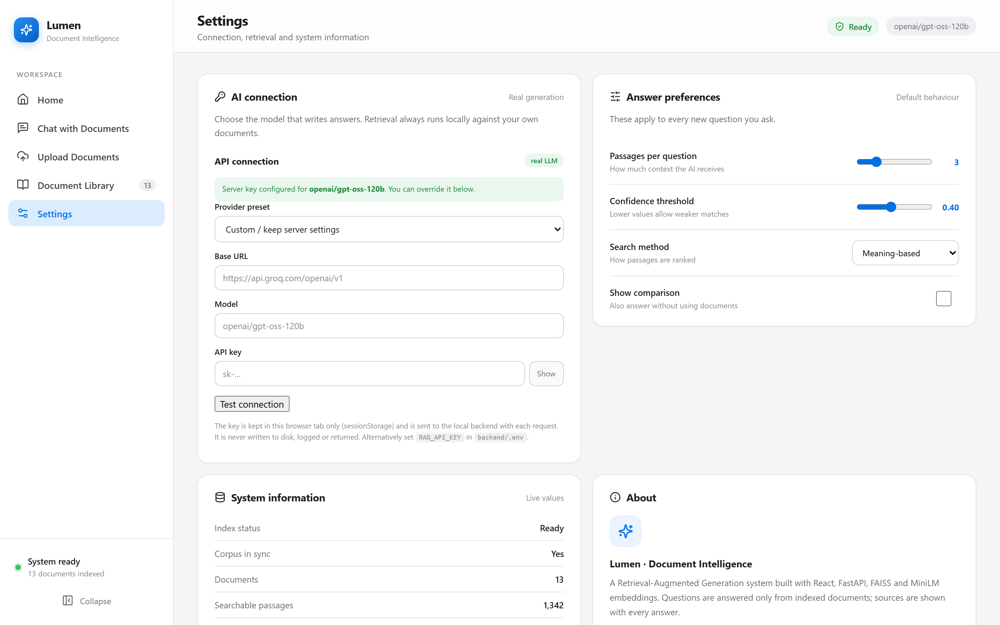

# Lumen · Document Intelligence RAG System

A Retrieval-Augmented Generation (RAG) application that answers questions **strictly from your own documents**. Lumen embeds your corpus, retrieves the most relevant passages with FAISS, and asks a language model to write a grounded answer — every claim is backed by a cited source passage you can expand and verify. If the retrieval score is too low, it honestly says *"I don't know"* instead of guessing.

Built for the Huawei Cloud AI RAG course project.

---

## ✨ Features

- **Grounded answers** — responses are generated only from retrieved document chunks, never from the model's parametric memory.
- **Honest abstention** — a configurable confidence threshold (`min_score`) suppresses answers when retrieval is weak (the classic out-of-domain refusal).
- **Cited sources** — each answer shows the exact passages used, with similarity scores and document origin.
- **Live document management** — upload `.txt` files and rebuild the index, or remove documents, all from the UI. The FAISS index is regenerated on every change.
- **Semantic + hybrid retrieval** — FAISS cosine search over `all-MiniLM-L6-v2` embeddings, with an optional TF-IDF hybrid mode.
- **Comparison mode** — optionally generate a "without documents" baseline answer to see the value of retrieval.
- **Polished Apple-inspired UI** — a calm, focused interface with sidebar navigation, live system status, and conversation streaming.

---

## 🖼️ Screenshots

### Home — Overview
The landing dashboard with system status, index statistics, and quick-start actions.



### Chat with Documents
Ask a question and get a grounded answer with expandable source passages. Answers stream in real time; the "best match" score is shown per response.



### Upload Documents
Drag-and-drop (or browse) UTF-8 `.txt` files. Uploading triggers an automatic index rebuild so new content is immediately searchable.



### Document Library
Browse every indexed document with its type, size, passage count, and indexing status. Remove a document to rebuild the corpus.



### Settings
Configure the LLM connection (provider, base URL, model, API key — kept in the browser tab only) and tune retrieval behavior (top-k, confidence threshold, search mode).



---

## 🏗️ Architecture

```
┌─────────────────┐      HTTP/JSON       ┌──────────────────────────┐
│  React + Vite   │  ─────────────────▶  │   FastAPI backend        │
│  (frontend)     │                      │                          │
│                 │  ◀─────────────────  │  /search  (semantic)     │
│  Chat · Library │      SSE stream      │  /ask     (streaming)    │
│  · Settings     │                      │  /documents (CRUD+rebuild)│
└─────────────────┘                      └───────────┬──────────────┘
                                                      │
                              ┌───────────────────────┼───────────────────────┐
                              ▼                       ▼                       ▼
                     Sentence-Transformers      FAISS index           LLM (OpenAI-compatible,
                     embeddings (384-d)         (artifacts/)          e.g. Groq / OpenAI)
```

| Layer        | Technology |
|--------------|------------|
| Frontend     | React 18, Vite, TypeScript, lucide-react |
| Backend      | FastAPI, Uvicorn, Server-Sent Events (streaming) |
| Embeddings   | `sentence-transformers/all-MiniLM-L6-v2` (384-dim) |
| Vector store | FAISS (cosine similarity) + optional TF-IDF hybrid |
| LLM          | Any OpenAI-compatible API (configured via `RAG_API_KEY` in `backend/.env`) |

---

## 🚀 Getting Started

### Prerequisites
- Python 3.11+
- Node.js 18+
- An OpenAI-compatible API key (e.g. Groq, OpenAI, OpenRouter) exported as `RAG_API_KEY`

### 1. Backend
```bash
cd backend
python -m venv ../.venv        # or use your preferred environment
../.venv/Scripts/python.exe -m pip install -r requirements.txt   # Windows
# On Linux/macOS: pip install -r requirements.txt

# Configure the LLM (server-side key, optional if set in the UI instead)
echo "RAG_API_KEY=sk-..." > .env

# Build the vector index from data/corpus/*.txt
python ../scripts/build_index.py --verify

# Start the API
uvicorn app.main:app --app-dir backend --host 127.0.0.1 --port 8000
```
The API will be available at `http://127.0.0.1:8000` (Swagger docs at `/docs`).

### 2. Frontend
```bash
cd frontend
npm install
npm run dev -- --host 127.0.0.1
```
Open `http://127.0.0.1:5173/`.

> The frontend expects the backend on `http://127.0.0.1:8000`. Adjust the API base in `frontend/src/api.ts` if needed.

---

## 📁 Project Structure

```
RAG_System/
├── backend/                 # FastAPI app, RAG pipeline, config
│   └── app/
│       ├── main.py          # API routes (/search, /ask, /documents, /health)
│       ├── rag.py           # retrieval + generation orchestration
│       └── config.py
├── data/corpus/             # source .txt documents (the knowledge base)
├── artifacts/               # generated FAISS index, chunks, manifest (gitignored)
├── frontend/                # React + Vite UI
│   └── src/
│       ├── views/           # Home, Chat, Documents, Settings
│       ├── components/      # Sidebar, TopBar, Message, Controls, ...
│       ├── api.ts           # backend client
│       └── styles.css       # design system
├── scripts/
│   ├── build_index.py       # index builder / verifier
│   └── capture_screenshots.py  # Playwright screenshot helper
└── screenshots/             # UI screenshots used in this README
```

---

## 🔌 API Summary

| Endpoint            | Method | Purpose |
|---------------------|--------|---------|
| `/health`           | GET    | Index status, model info, defaults |
| `/search`           | POST   | Semantic/hybrid retrieval (top-k passages) |
| `/ask`              | POST   | Streaming RAG answer (SSE) with sources |
| `/documents`        | GET    | List indexed documents |
| `/documents`        | POST   | Upload documents + rebuild index |
| `/documents/{name}` | DELETE | Remove a document + rebuild index |

---

## 🔐 Notes on Secrets
- The optional server key lives in `backend/.env` (`RAG_API_KEY`) and is **never** returned by the API.
- The in-UI API key (Settings) is stored only in the browser tab's `sessionStorage` and sent to the local backend per request — it is never written to disk or logged.

---

## 📄 License
This project is provided for educational use as part of the Huawei Cloud AI RAG course.
